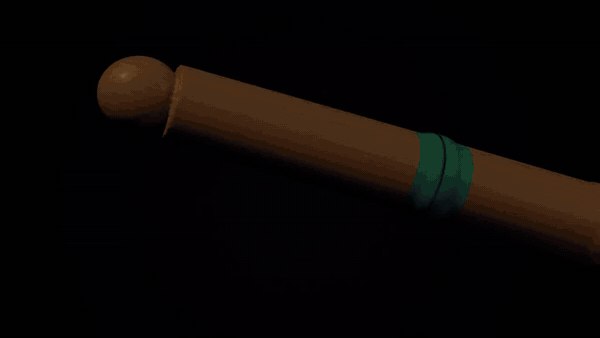

# Click Joints

**Click where it should bend, and Click Joints cuts a printable ball joint that fits, and shows how far it bends before you print.**

Free on the [Blender Extensions platform](https://extensions.blender.org/add-ons/click-joints/). Blender 4.2 LTS, 5.2 LTS and 5.3.

## Free

- Ball and socket, or pin and hole, cut into two watertight parts
- Measured bend range of every ball joint, in degrees; past the limit it turns red
- Fit ring on the cut: green good, yellow tight, red too thin
- Auto size: the largest ball with a good fit, or a clear message when none fits
- Clearance in mm (0.1 to 0.3 mm is typical)
- Exploded view, and "Make watertight" for messy meshes (on a copy)
- Export as STL or 3MF, one file per part, in millimetres

## Pro, in addition to everything above

- Printable click hinge for knees and elbows, with an end stop at 90°, 115° or 135°
- A pose slider per hinge
- Red marks on both parts when you pose past the stop
- Spacing checks between joints

Personal license $12, studio license (up to 5 people) $45, all Pro 1.x updates included: https://duinhouwer8.gumroad.com/l/click-joints-pro

The free Click Joints stays free and keeps getting fixes. What changed in each version: [CHANGELOG.md](CHANGELOG.md).

## Install

Edit > Preferences > Get Extensions, search "Click Joints". Or download the zip from the releases and use Install from Disk.

## Report a problem

Open an issue here: https://github.com/thijsduinhouwer2002-coder/click-joints/issues

Please include your Blender version, what you clicked, and the message the panel showed. A small .blend file helps a lot.

Email: thijs@dortus.com

## License

GPL-3.0-or-later. See [LICENSE](LICENSE).
